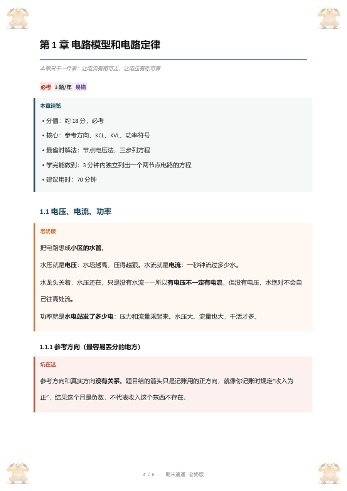
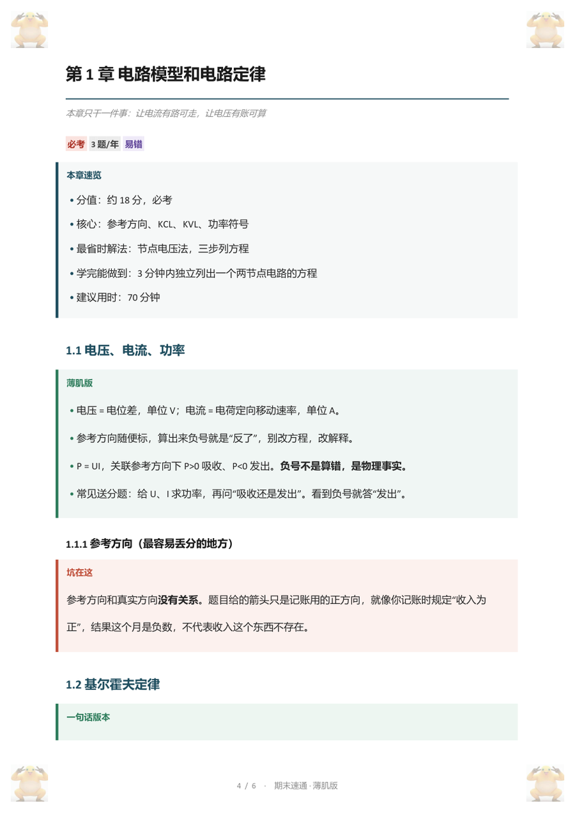
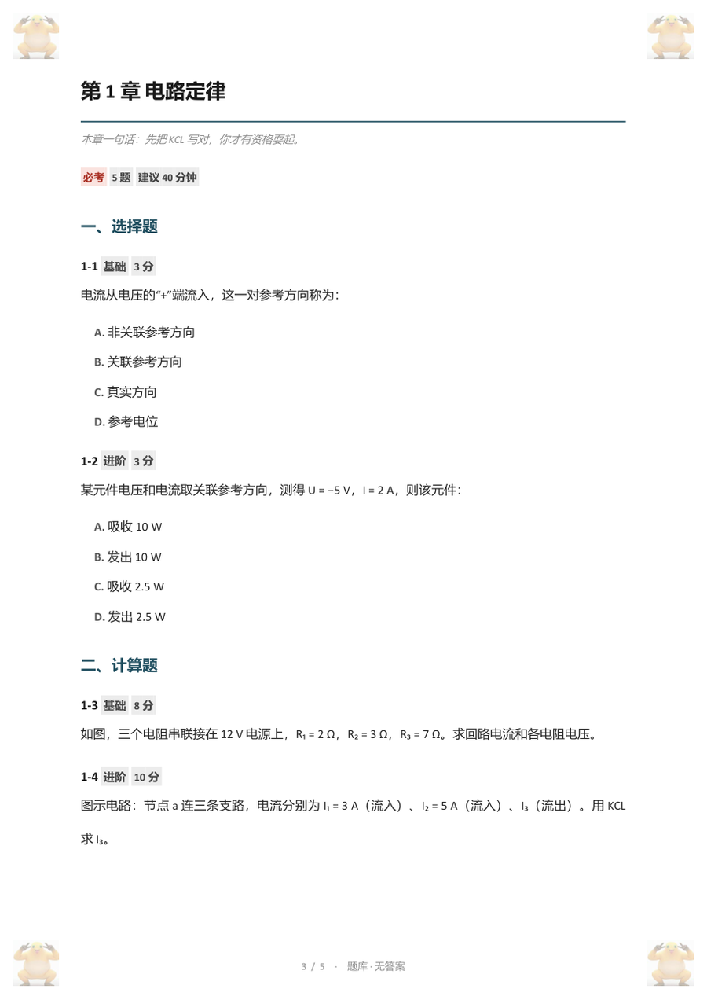
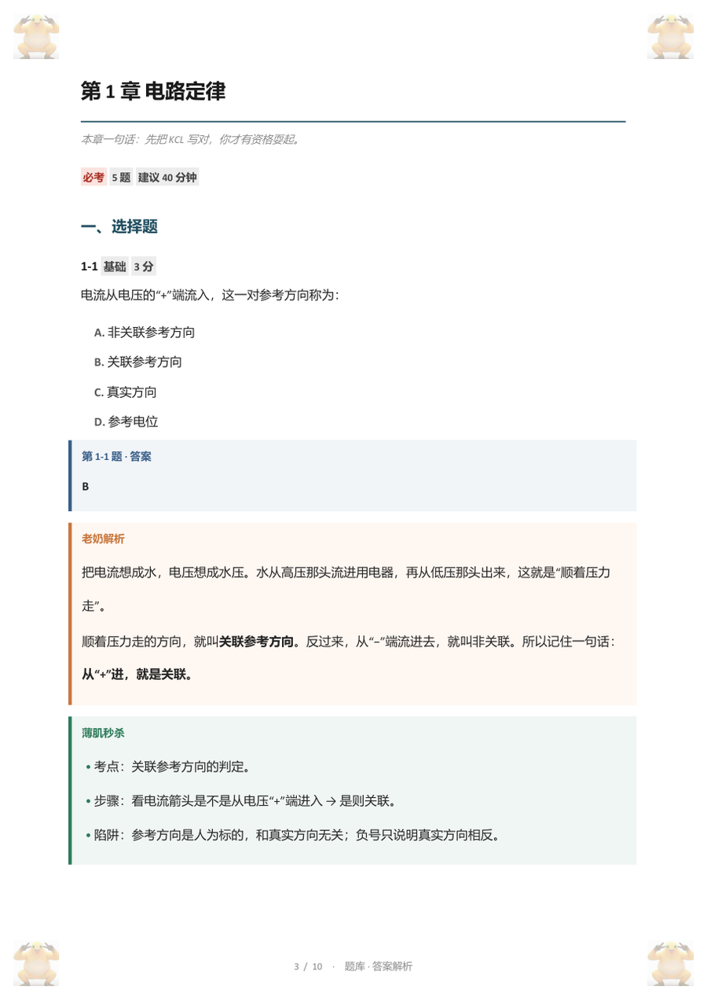

<p align="center">
  
</p>

<h1 align="center">期末速通 · Final Cram</h1>

<p align="center">
  <b>3 小时，从「这是啥」到「这我会」。</b><br>
  把 PDF / PPT / 作业 / 真题，压成四份能直接用的 Word。
</p>

<p align="center">
  
  
  
  
  
</p>

> 喔~可以耍起了耶。诶~真的假的可以吗。那我也是直接耍起走了。
>
> —— 本项目的产品哲学：压力已经够大了，能少背一点是一点。

---

## 这玩意儿解决什么问题

大学期末的真相：

- 课件 200 页，老师只说「回去自己复习」；
- 作业写了，但不知道哪道会考；
- 离考试还有 3 小时，书还没翻开。

`final-cram` 不负责让你「学完」，只负责让你**拿分**：

1. **先砍范围**：考什么、不考什么、每章花几分钟，先写清楚；
2. **再讲人话**：每个知识点先给生活比喻，再给考试原话；
3. **最后出题**：按章去重，题目和答案物理隔离，解析写两版。

> 它不生产知识，只做知识的搬运、压缩和贴标签。

## 四份产出

| 文件 | 给谁看 | 特点 |
| --- | --- | --- |
| `01_速通笔记_老奶版.docx` | 完全零基础 | 生活比喻 + 考试原话，我奶奶都能听懂 |
| `01_速通笔记_薄肌版.docx` | 有基础但只剩 3 小时 | 结论先行，只留会考的 |
| `02_通关题库_无答案.docx` | 自测 | 按考察点去重，题目里没有任何答案痕迹 |
| `03_通关题库_答案解析.docx` | 对答案 | 每题三段：答案 / 老奶解析 / 薄肌秒杀 |

Word 里还顺手做了：可点击目录、每章返回目录、四角水印、页码、标签胶囊，以及每章开头一张正常的「本章速览」卡片。

## 长这样

<p align="center">
  
  
</p>
<p align="center">
  
  
</p>

## 两种声音

| | 老奶版 | 薄肌版 |
| --- | --- | --- |
| 第一句 | 「把电路想成小区水管」 | 「从 + 进，就是关联」 |
| 适合 | 上课只记得老师姓什么 | 上过课，但全忘了 |
| 每点长度 | 120–200 字 | 40–80 字，或一张 3 行表 |
| 风险 | 看得慢 | 看得太快，以为自己会了 |

同一个知识点写两遍，不是换个语气，是换一套信息结构。老奶版负责「懂」，薄肌版负责「背」。

## 3 小时怎么用

1. **0–10 分钟**：翻到全书的速记页（文科课是「提词器」），只看关键词对应；
2. **10–140 分钟**：按章过薄肌版，每章只看必背、易混、考场信号；
3. **140–165 分钟**：做每章代表题，错题回对应章；
4. **165–180 分钟**：回到速记页，不再看新内容。

> 时间不够时，整章跳过低频章节。不要每章都只看一半——那是平均主义，期末不认。

## 安装

### 方式一：下载 Release

从 [Releases](https://github.com/liamcao-zs/final-cram/releases/latest) 下载 `final-cram-v1.1.zip`，解压后把 `final-cram/` 放进：

```
~/.claude/skills/
```

### 方式二：从仓库复制

```bash
git clone https://github.com/liamcao-zs/final-cram.git
cp -r final-cram/skill ~/.claude/skills/final-cram
```

### 环境

- Windows 10/11
- Python 3.10+
- Microsoft Word / PowerPoint（导出整页图、视觉验收用）

```bash
pip install -r skill/requirements.txt
```

从 Release 安装时，路径换成 `~/.claude/skills/final-cram/requirements.txt`。

## 用一句话开始

把资料丢进一个文件夹，然后说：

> 用 final-cram 帮我速通这门课，还有 3 小时。

它会先问你三件事：考到哪、什么题型、哪几章最虚。不想回答就说「你定」。

## 它怎么保证不糊弄

不是「生成完就说好了」。交付前会跑 14 项机械检查：

- 题号是否一一对应、答案是否每题都有；
- 答案字母是否真的在选项里（计算题不会被误判）；
- 无答案版是否混入答案；
- 答案版和无答案版的题干是否逐题一致；
- 每章题号是否从 1 开始且连续；
- 题目之间是否近重复（同公式换数字会被抓出来，阈值 0.86）；
- 引用的图片是否都存在，写了「如图」却整篇没图会被提醒；
- 两版笔记的章节是否对齐，每章是否有「本章速览」；
- 表格列数、front matter、游戏化措辞……

另外还有几条硬规矩：每题必须自己算过、材料没有的内容标 `（AI补充）`、秒杀招式必须带适用条件。

**它不会假装自己什么都知道。** 没有真题就写「经验估计」，材料没覆盖就写「AI 补充」，拿不准的宁可标注，不编。

## 适合谁

- 明天考试，今天开始；
- 课件很多，不知道从哪看；
- 需要有人替你砍范围、排顺序、出题。

## 不适合谁

- 想系统学一遍的——这是速通，不是教材；
- 需要老师手把手讲 10 小时的；
- 指望 AI 替你背的。AI 只能替你压缩，背还得你自己来。

## 已知限制

- **Windows + Office 专用**：PPT 转整页图走 PowerPoint COM，视觉验收走 Word COM；没有 Office 时只能生成 docx，不能验收。
- **公式是 Unicode + 上下标**，不是 Word 原生公式。积分、分式、矩阵会以文本形式呈现。
- **没有真题时，重要度是估的**：按题库题量、PPT 页数、作业频次推断，边界卡里会标「经验估计」。
- 课程原始资料（PDF、题库、输出文档）放在 `private/`，已 gitignore，不会上传。

## 仓库结构

```
final-cram/
├── skill/            # 可安装的 Claude Skill
│   ├── SKILL.md
│   ├── references/   # 7 份规范
│   ├── scripts/      # 6 个脚本
│   ├── examples/     # 示例源文件
│   ├── assets/       # 水印与图标
│   └── requirements.txt
├── .github/          # CI：语法检查 + 示例自检
├── docs/             # README 预览图
├── assets/           # 512×512 图标
├── dist/             # 本地打包产物，gitignore，发 Release 时附上
└── private/          # 本地课程资料，不上传
```

## 彩蛋

- 老奶版：这东西就是把老师那本书，挑能考的，用你听得懂的话再说一遍。
- 薄肌版：别看了，直接翻提词器。

## 更新日志

- **v1.1.0** — 修复 `check_docs.py` 把计算题误判为「缺答案字母」；新增「题干一致」「题号连续」「本章速览」「如图无图提醒」四项自检；修复文档命令块里复制即报错的字面 `\n`；PPT 备注改为按关系文件读取；补 `requirements.txt`。
- **v1.0.0** — 首个公开版本。

## License

[MIT](LICENSE)
